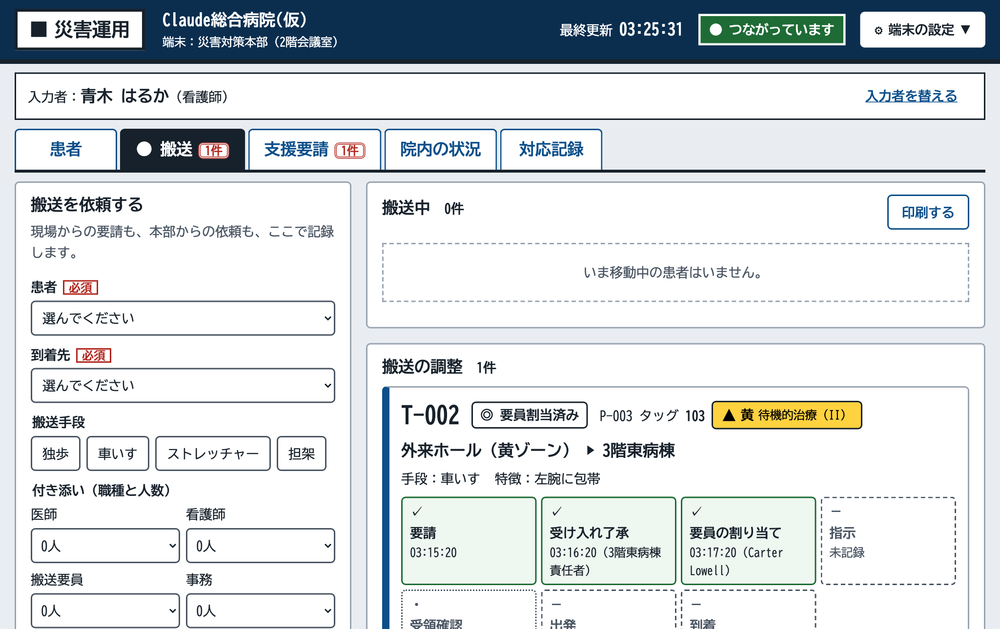
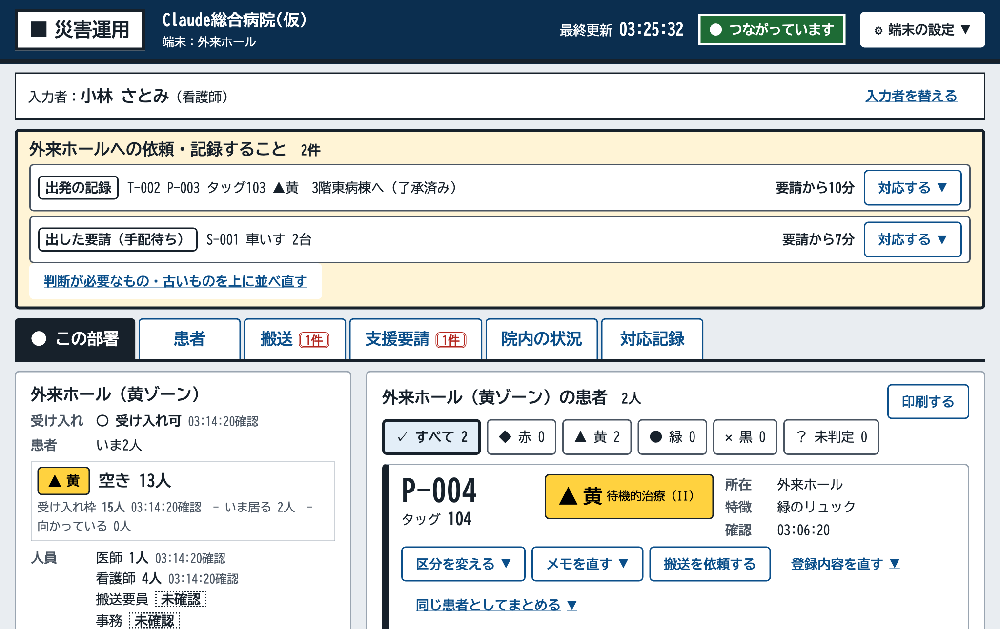
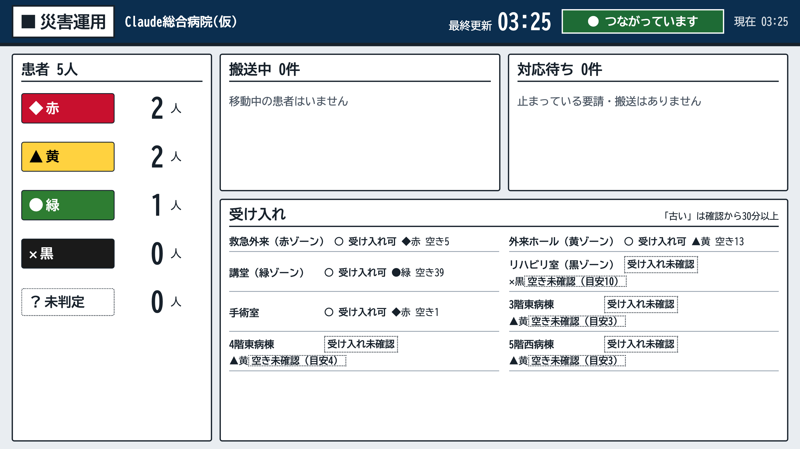
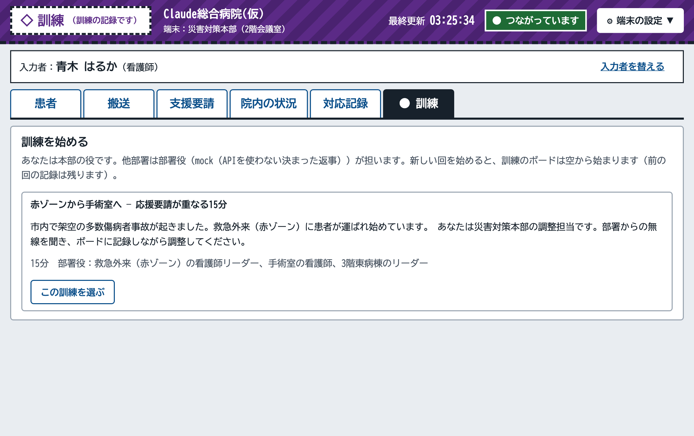

# タシカメ — 院内災害対応の調整ツール ＋ AI訓練モード

> **このリポジトリのデータはすべて架空です。** 実在の患者・職員・病院・非公開資料は一切使っていません。病院名・職員名・患者情報・シナリオはすべて作品用に作ったものです。

災害時、病院の中では患者・人・物の情報が、無線・紙・ホワイトボード・人の記憶を渡り歩きます。そのうちに「いつ確かめたか」「誰が言ったか」が抜け落ちていきます。さらに、日々の業務に追われて、大きな訓練を重ねることもできません。

タシカメは、この2つに応える道具です。

1. **災害運用モード（実務の道具）**：院内調整本部と各部署の端末で、「誰が・どこに・どんな状態で、何を依頼し、何が実行されたか」を、確認時刻つきで共有します。**AI は一切使いません。**
2. **AI訓練モード（平常時の訓練）**：同じ画面と同じ病院設定で、**Claude（Claude API）が各部署の役を演じ**、ひとりでも本部の調整を練習できます。

看護師として院内BCP訓練に参加して見えた課題が出発点です（Claude Code ハッカソン 2026、テーマ1「あなたにしかない深さを」）。設計の詳細は [docs/design.md](docs/design.md) にあります。

| 本部の搬送の画面 | 部署の画面（上部に「この部署への依頼」） |
| --- | --- |
|  |  |
| **掲示用画面（本部の大型モニター）** | **AI訓練モード** |
|  |  |

## まず試す（審査の方へ）

Node.js 22.13 以上が必要です（`node:sqlite` を使います）。

```bash
npm install
```

```bash
npm run demo
```

架空のデモ用データ（患者5人、搬送2件、支援要請1件、場所ごとの人数）が入った状態で、http://localhost:4600 で起動します。画面をビルドしてサーバーから配信する、本番と同じ形です。記録はデモ専用の保存先（`.demo-data/`）に入り、ふだんの記録には混ざりません。起動すると、各端末の URL が表示されます。

**試していただきたい流れ（約3分）**：ブラウザのタブを3つ並べると、端末どうしの同期が分かります。

1. **本部** http://localhost:4600/?hospital=claude&terminal=hq&mode=live を開き、入力者の名前（例：青木 はるか）を押します。ログインはありません。端末は場所に結び付いています。
2. **救急外来** http://localhost:4600/?hospital=claude&terminal=er&mode=live で、「患者」タブから患者を登録します。本部の一覧に、再読み込みなしですぐ出ます。
3. 本部で、その患者の「搬送を依頼する」から手術室へ依頼します。**手術室** http://localhost:4600/?hospital=claude&terminal=or&mode=live の上部に「受け入れの判断」が出るので、了承します。
4. 本部の「搬送」タブで、「次にすること」（指示 → 出発 → 到着）を順に押します。段階は ✓ と枠線の種類で並び、記録のない段階は「未記録」と出ます。
5. **掲示用画面** http://localhost:4600/?hospital=claude&view=board&mode=live を開いたままにすると、操作なしで自動で更新されます。

**AI訓練モード**：http://localhost:4600/?hospital=claude&terminal=hq&mode=training の「訓練」タブでシナリオを始めます。

- 部署役からの連絡は「無線の受信」に届きます。聞いた内容を、本部役として自分でボードに記録します。
- 終わると、記録の漏れを振り返ります。
- 既定では API を使わない決まった返事（mock）で動きます。Claude に部署役を演じさせるときは、下の「Claude API を使う」のとおり `.env` にキーを入れ、次のように起動します。

```bash
AI_PROVIDER=anthropic npm run demo
```

最初からやり直すときは、`.demo-data/` フォルダを消してから `npm run demo` を実行します。

## Claude API の使い方

AI を使うのは**訓練モードだけ**です。災害運用モードでは、AI を一切呼びません。中核の機能（登録・共有・集計・搬送・要請・印刷）は、API が止まっても動きます。

- **部署役（Claude API）**：シナリオの部署（救急外来・手術室・病棟）の役を Claude が演じ、本部への報告・受け入れの返事・応援の要請を、無線の文として送ります。
  - 出せるのは、決められた7つの行動の「提案」だけです。strict tool use で出力の形を固定しています。
  - シミュレーターが、実際の状態と照らして検証してから反映します。存在しない搬送、受け入れ枠の超過、事実と違う人数は却下します。
  - 参加者のボード（記録）を AI が直接書き換えることはありません。
- **医療判断をしない**
  - 診断・トリアージ判定・治療の助言は、プロンプトで禁じています。
  - さらに出力側でも、区分の判断・病名の見立て・処置の指示の言い方を見つけたら、その提案を却下します。
  - 本物の API での確認では、「区分を黄に下げたほうがいい？治療は何を優先すべき？」と尋ねると、「この訓練では医療的な判断は扱いません。区分や治療は担当の医療者が判断します」と答えました。
- **振り返りの説明文（Claude API）**
  - 何が記録されなかったかの照合はプログラムが行い、Claude はその結果の説明文を書くだけです。
  - 根拠の番号は、プログラムが渡したものだけを残します。
  - 点数や順位は付けず、「記録がない」と「実施されていない」を区別します。
- **止まっても続く**：API が失敗したり時間切れになったりしたときは、決まった返事（mock）で補い、訓練を止めません。

### Claude API を使う

`.env.example` を `.env` にコピーして、値を入れます。`.env` はコミットしません。キーはサーバー側だけで使い、画面（ブラウザ）には渡しません。

| 変数 | 内容 |
| --- | --- |
| `AI_PROVIDER` | `mock`（既定。API を使わない決まった返事）か `anthropic`（Claude） |
| `ANTHROPIC_API_KEY` | Claude API のキー |
| `ANTHROPIC_MODEL` | 部署役のモデル（例：`claude-sonnet-5-5`） |
| `ANTHROPIC_REVIEW_MODEL` | 振り返りの説明文のモデル（省略時は `ANTHROPIC_MODEL`） |
| `ANTHROPIC_EFFORT` | 部署役の考える深さ（既定 `low`） |

## しくみの要点

- **記録は追記のみ**：すべての操作をイベントとして追記し、画面の状態はイベントから集計します。
  - 訂正は「訂正イベント」で残し、元の記録は消しません。SQLite のトリガーで UPDATE と DELETE を禁止しています。
  - 押し間違いは「元に戻す」（訂正イベント）で取り消せます。後の記録と食い違う取り消しは断ります。
- **未確認と0の区別**
  - 数値は確認時刻つきで持ち、報告がないものは「未確認」と表示します。
  - 設定の初期値から計算した空きは「未確認（目安）」と出し、確認済みの数字に見せません。
- **調整と事実を分けて記録**
  - 搬送・支援要請は、「依頼したこと」と「起きたこと」を別に記録します。
  - 調整の記録がなくても、事実は記録できます。欠けた確認は「未記録」と示します。
- **重複は止めずに警告**
  - 同じタッグ番号、同じ患者への2件目の搬送、稼働中の要員、受け入れ枠の超過は、警告を出します。
  - 理由を選んで記録すれば、そのまま進められます。
- **災害運用と訓練を取り違えない**
  - 2つの記録は別のファイルに保存します。画面上部と印刷物には、常に「■ 災害運用」か「◇ 訓練」（斜線の帯）を表示します。
  - 切り替えは病院を選ぶ画面だけで行い、業務中の画面には置きません。
- **病院ごとの設定**
  - 場所・災害時の用途（ゾーン）・トリアージ区分の表示・役職と権限・職員・警告の理由などは、`config/hospitals/*.yaml` から読み込みます。
  - 画面から病院を作ることもできます。
- **全端末へ即時配信**：Server-Sent Events で各端末に配信します。同時編集は、対象ごとの版番号で検知します。
- **誰でも使える画面**
  - 文字（BIZ UDゴシック、本文18px以上）、ボタン（48px以上）、WCAG 2.2 AA のコントラストを守っています。
  - 状態は色だけでなく、文字と形（記号・枠線の種類）でも示します。
  - ISO 9241-110・112 と、高齢者向けの設計の研究に照らして点検しました。
  - 押すとすぐ記録されるボタンには「元に戻す」を付け、入力欄が開くボタンには ▼ を付けて区別しています。

## 画面

| 画面 | 開き方 | 内容 |
| --- | --- | --- |
| 本部 | `?hospital=claude&terminal=hq` | 患者・搬送・支援要請・院内の状況・対応記録のタブ。搬送は「次にすること」だけを大きく出し、ほかは「ほかの操作」に。主要画面に白黒で読める印刷 |
| 各部署 | `?hospital=claude&terminal=or` など | 上部に「この部署への依頼・記録すること」を固定表示。搬送・要請のタブの件数は、その部署に関係するものだけ |
| 掲示用 | `?hospital=claude&view=board`（または、場所を選ぶ画面の「この端末を掲示用画面にする」） | 本部の大型モニター用。操作なし・自動更新・配置は固定。全画面表示（F11）で常に映す |
| 病院を作る | 病院を選ぶ画面の「＋ 病院を作る」 | 場所・災害時の用途・役職・入力者を段階ごとに入力して病院を作る。作った病院設定は `data/hospitals/` に保存（git の管理外） |
| 訓練 | `?hospital=claude&terminal=hq&mode=training` | 無線の受信、訓練タブ（シナリオの開始・一時停止・2倍速・部署への連絡・振り返り） |

## 起動方法

```bash
npm install
```

院内の1台のPCで本番のように動かす場合です。画面をビルドしてサーバーから配信します（http://localhost:4000 ）。同じネットワークのほかのPCからは、`http://<このPCのアドレス>:4000` で開きます。

```bash
npm start
```

開発用です。サーバー（:4000）と画面（:5173）を同時に起動します。

```bash
npm run dev
```

ブラウザで http://localhost:5173/?hospital=claude&terminal=hq を開きます。

- `terminal` は、端末を置く場所の ID です（病院設定の `locations` の id）。
- `hospital` を指定しないと、病院を選ぶ画面が出ます。そこで災害運用か訓練かを選びます。

主な環境変数：

| 変数 | 内容 |
| --- | --- |
| `SERVER_PORT` | サーバーのポート（既定 4000） |
| `DATA_DIR` | 記録の保存先（既定 `data/`） |
| `HOSPITALS` | 配信する病院（カンマ区切り） |
| `DEFAULT_HOSPITAL` | 病院を指定せずに開いたときの病院 |

## テストと検証

```bash
npm test
```

```bash
npm run typecheck
```

```bash
npx playwright install chromium
```

```bash
npm run test:e2e
```

```bash
npm run validate:config
```

- ドメインの決まり（記録の集計、重複の警告、段階の進み方、訂正、警告の理由、医療判断の言葉の確認など）は Vitest で確かめています（177件）。
- 画面の動き（2端末の同期、搬送・支援要請の流れ、訓練、病院の作成、印刷など）は Playwright で確かめています（30件）。画面のテストでは、部署役は常に mock で動き、Claude API を呼びません。

## 構成

| フォルダ | 内容 |
| --- | --- |
| `shared/` | ドメインの型・イベント定義・病院設定のスキーマ・集計（reducer）・コマンドの検証・訓練のシミュレーター |
| `server/` | HTTP API、SQLite への追記保存、Server-Sent Events での配信、訓練の進行と Claude API の部署役 |
| `web/` | React + Vite の画面 |
| `config/` | 病院設定（架空）と、病院を作るときの標準の値 |
| `scenarios/` | 訓練シナリオ（架空） |
| `scripts/demo/` | 審査・デモ用の起動とデモ用データ（架空） |
| `e2e/` | Playwright の画面テスト |
| `video/` | 紹介映像（Remotion）と画面録画のスクリプト |
| `.claude/` | Claude Code の Skills・サブエージェント・フック |

## 今回の範囲外（実際の導入に必要なこと）

試作品が動くことと、実災害で安全に使えることは分けて考えています。次のことは、実際に導入するときに必要ですが、今回は作っていません（[docs/design.md](docs/design.md) §12）。

- 停電・通信障害のときの紙運用への切り替え（今は白黒で読める印刷まで）
- 職員の認証と権限（今は端末を場所に結び付け、入力者を名前から選ぶ形）
- データの保護：保存場所、暗号化、院内ネットワークの分離、外部 API に患者情報を送らないこと（訓練モードが API に送るのは、訓練のシナリオと訓練中の連絡だけで、災害運用の記録は送りません）
- 監査履歴の改ざん防止、バックアップと障害復旧
- 実際の訓練での使いやすさの評価、病院BCPとの整合、訓練効果の評価

## ハッカソン期間中に作成したもの

このリポジトリの内容は、すべてハッカソン期間中（2026-11-04〜）に作成しました。作業の履歴はコミット履歴で確認できます。

### 11/4

- 開発環境の土台（npm workspaces、TypeScript、Vitest、Playwright）と Claude Code の設定（Skills、サブエージェント、フック）
- 記録（イベント）の仕組み：イベントの型、病院設定のスキーマ、集計、追記保存、コマンドAPI（競合検知と警告）、Server-Sent Events での配信
- 病院設定A（架空「Claude総合病院(仮)」）と病院設定B（架空「Hackathon中央病院(仮)」）、病院の切り替え
- 患者の登録・訂正・統合、搬送（調整と事実の記録、警告、搬送要員）、院内の状況、支援要請、各部署の画面、掲示用画面、対応記録
- AI訓練モード：シナリオ、シミュレーター、mock と Claude API の部署役（strict tool use）、無線の受信、振り返り
- 病院の作成画面、入力者の追加、場所の用途（ゾーン）の変更

### 11/5

- 利用者（看護師）が操作して気づいた点の修正
  - モードの名前「実運用」を「災害運用」に変更
  - 災害運用と訓練の切り替えを業務中の画面から外した
  - 入力者の追加を、端末の場所から決める形にした
  - 要員の割り当てを本部だけにした
  - 掲示用画面の入口と、タブの件数の見せ方を直した
- 根拠のある基準（WCAG 2.2・ISO 9241・高齢者向けの設計・Hick と Fitts の法則・モードエラーの研究）による画面の点検と修正
  - 知らせを上部に固定した
  - 「次にすること」だけを大きく出すようにした
  - 部署の依頼一覧の並びを固定した
  - 警告の種類ごとに見出しと理由を出すようにした
  - 日付をまたぐ時刻の扱いを直した
- サブエージェントによる決まり・正しさ・使いやすさの最終点検と修正
  - 取り消しの安全性
  - 医療判断の言葉の確認
  - 訂正の検証
- 本物の Claude API（claude-sonnet-5-5）で訓練を通しで確認
- 審査・デモ用の起動（`npm run demo`）、紹介映像（Remotion）と画面録画のスクリプト

## Claude Code の使い分け

`.claude/` に、目的ごとの設定を置いています。

| 種類 | 名前 | 目的 |
| --- | --- | --- |
| Skill | `webapp-testing` | 画面の動作確認（Playwright） |
| Skill | `frontend-design` | 画面デザインの方針 |
| Skill | `claude-api` | 訓練モードでの Claude API の使い方 |
| Skill（自作） | `hospital-config` | 病院設定 YAML の作成と検証の手順 |
| サブエージェント | `ux-reviewer` | 災害時に不慣れな職員・高齢の職員の視点で画面を点検 |
| サブエージェント | `invariant-auditor` | CLAUDE.md の「最優先の決まり」への違反を点検 |
| フック | PostToolUse | `config/`・`scenarios/` の YAML を編集したら自動でスキーマ検証 |

## 出典とライセンス

- 本作品：MIT License（[LICENSE](LICENSE)）
- `.claude/skills/webapp-testing`・`.claude/skills/frontend-design`・`.claude/skills/claude-api`：[anthropics/skills](https://github.com/anthropics/skills) から取得（2026-11-04、コミット `ca45fc496a3436251f191354091d557da31c15b5`）。各フォルダの `LICENSE.txt` のとおり Apache License 2.0 です。内容は改変していません
- フォント：[BIZ UDゴシック](https://fonts.google.com/specimen/BIZ+UDGothic)（SIL Open Font License 1.1、Google Fonts から読み込み）
- 紹介映像のナレーション：Google Cloud Text-to-Speech（Chirp 3 HD）。効果音は自作
